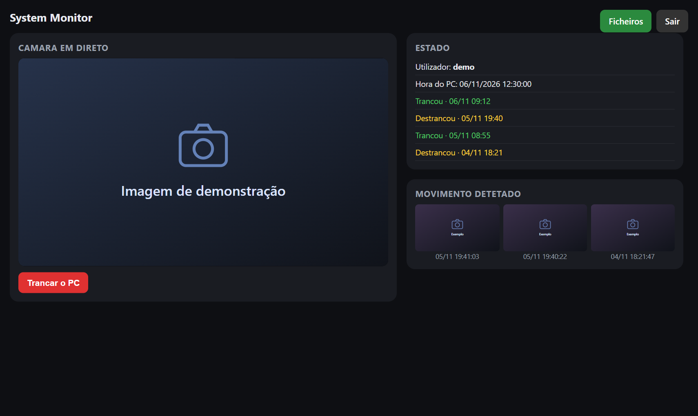
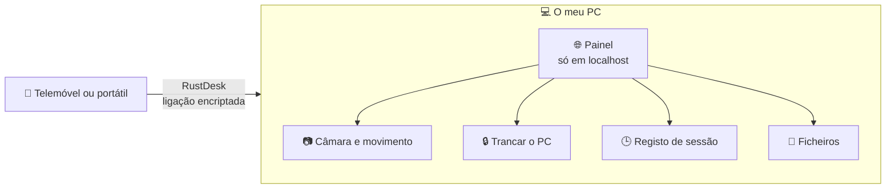
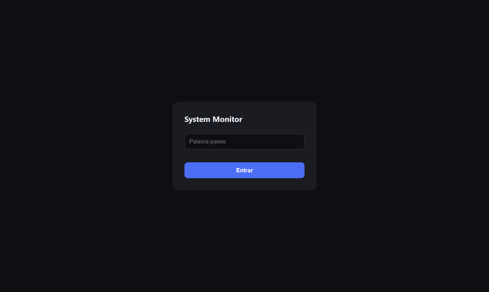
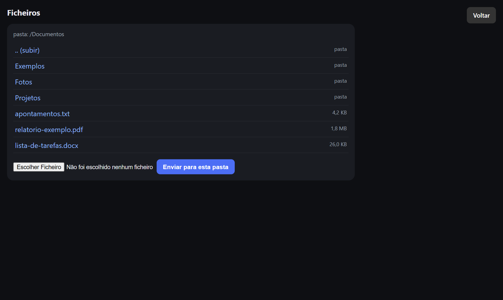
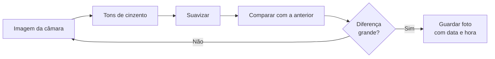

# 🖥️ System Monitor

**Um painel feito em Python para acompanhar o próprio PC à distância, sem o expor à internet.**

 

 

> [!NOTE]
> Esta página só apresenta o projeto. **O código é privado.** Foi feito para uso no próprio computador e no próprio espaço. As imagens mostram a interface real com dados de exemplo: a câmara não foi usada, e o quadro da imagem e as capturas são de demonstração.

## 🎯 O objetivo

Resolver dois problemas simples:

1. Saber se alguém mexeu no computador ou entrou na divisão durante a ausência.
2. Aceder ao PC e aos ficheiros à distância, sem aceitar ligações à mão.

O desafio foi fazê-lo sem criar um risco maior do que o problema. Por isso, a segurança veio primeiro.

## 🧱 Como funciona

O projeto tem duas camadas:

| Camada | O que faz |
|---|---|
| **O painel** | Um pequeno site que corre no PC e só responde em `127.0.0.1` |
| **O acesso de fora** | Uma ferramenta de acesso remoto encriptada, que liga ao PC antes de abrir o painel |

**Porquê assim?** A parte perigosa de um programa destes é expô-lo à internet com a segurança mal feita. Fechando o painel no próprio PC e usando uma ferramenta testada para a ligação, não fica nenhuma porta aberta no router.

## ✨ O que faz

| Função | Descrição |
|---|---|
| 📷 **Câmara em direto** | Mostra a imagem da webcam no browser |
| 🏃 **Deteção de movimento** | Guarda uma foto com a data e a hora quando algo se mexe |
| 🔒 **Trancar o PC** | Bloqueia a sessão do Windows com um botão |
| 🕒 **Registo de sessão** | Mostra quando a sessão foi trancada e destrancada, para detetar acessos fora de horas |
| 📁 **Ficheiros** | Navega nas pastas, descarrega para o telemóvel e envia para o PC |
| 🚀 **Arranque automático** | Começa a funcionar sozinho ao entrar no Windows |
| ⚙️ **Configurável** | Câmara, sensibilidade, deteção de movimento e pasta dos ficheiros |

## 🖼️ Visita guiada

### Painel principal

A imagem da câmara à esquerda e, à direita, o estado do PC, as últimas sessões e as capturas de movimento.

### Entrar

Todo o acesso exige palavra-passe.

### Ficheiros

Navegar nas pastas, descarregar e enviar ficheiros, sem conseguir sair da pasta definida.

## ⚙️ Como foi construído

**Deteção de movimento:** cada imagem da câmara passa a tons de cinzento, é suavizada e comparada com a anterior. Se a diferença ultrapassar a sensibilidade definida, o programa guarda uma foto. A sensibilidade evita falsos alarmes causados por sombras e mudanças de luz.

**Vídeo em direto:** a câmara é lida numa tarefa separada e cada imagem é enviada ao browser em JPEG, para a página não bloquear.

**Registo de sessão:** o programa lê os eventos de trancar e destrancar diretamente dos registos de segurança do Windows.

**Instalação:** um script PowerShell instala o que falta, pede a palavra-passe, prepara a pasta e cria uma tarefa agendada para o arranque automático.

## 🔒 Segurança

| Risco | Como foi tratado |
|---|---|
| Exposição à internet | O painel só escuta em `127.0.0.1`, sem portas abertas no router |
| Acesso sem autorização | Todas as páginas exigem login e sessão |
| Palavra-passe roubada do ficheiro | Fica guardada em resumo (hash), nunca em texto |
| Sair da pasta de ficheiros | Cada caminho é verificado para ficar dentro da pasta definida |
| Nomes de ficheiros maliciosos | Os nomes enviados são limpos antes de gravar |
| Dados pessoais no Git | Definições, palavra-passe e fotos ficam fora do repositório |
| Uso indevido da câmara | Foi feito para o próprio espaço, e a luz da webcam acende sempre que a câmara está ativa |

## 🛠️ Tecnologias

| Área | Tecnologia |
|---|---|
| Linguagem | Python |
| Servidor web | Flask |
| Câmara e imagem | OpenCV |
| Interface | HTML, CSS e JavaScript |
| Instalação | PowerShell e tarefa agendada do Windows |
| Acesso remoto | RustDesk |

## 💡 O que aprendi

- Pensar nos riscos antes de escrever funcionalidades.
- Separar o programa da forma de lhe aceder torna tudo mais simples e mais seguro.
- Processar vídeo em direto, sem bloquear a página.
- Usar os registos do Windows como fonte de informação.
- Empacotar um programa para se instalar com um único script.
