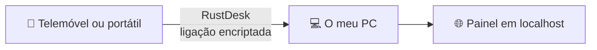

# System Monitor

**Um pequeno painel, feito em Python, para acompanhar o próprio PC à distância e com segurança.**

 

> [!NOTE]
> Esta página só apresenta o projeto. **O código é privado.** Foi feito para uso no próprio computador.

## O objetivo

Saber se alguém mexeu no computador durante a minha ausência e conseguir aceder a ele à distância, sem abrir nenhum serviço à internet.

## Como funciona

A decisão mais importante foi de segurança: o painel responde apenas no próprio computador. O acesso de fora passa por uma ferramenta de acesso remoto encriptada, por isso o programa não fica exposto à internet.

## O que faz

| | |
|---|---|
| 📷 **Câmara em direto** | Mostra a imagem da webcam no browser |
| 🏃 **Deteção de movimento** | Guarda uma foto com a data e a hora quando algo se mexe |
| 🔒 **Trancar o PC** | Bloqueia a sessão do Windows à distância |
| 🕒 **Registo de sessão** | Mostra quando a sessão foi trancada e destrancada |
| 📁 **Ficheiros** | Passa ficheiros entre o PC e o telemóvel |
| 🚀 **Arranque automático** | Começa a funcionar ao entrar no Windows |

## O que aprendi

- Pensar na segurança antes de escrever funcionalidades.
- Separar o programa da forma de lhe aceder.
- Guardar palavras-passe em resumo (hash), e nunca em texto.
- Deixar dados e definições pessoais fora do Git.

## Tecnologias

| Área | Tecnologia |
|---|---|
| Linguagem | Python |
| Interface | Página web local |
| Instalação | PowerShell |
| Acesso remoto | RustDesk |
| Plataforma | Windows |
